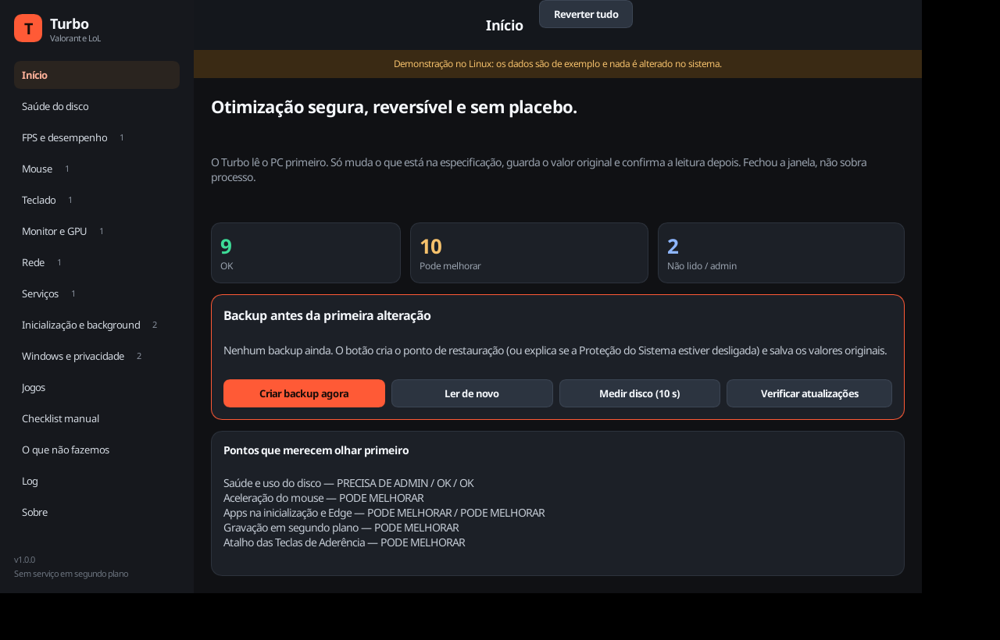
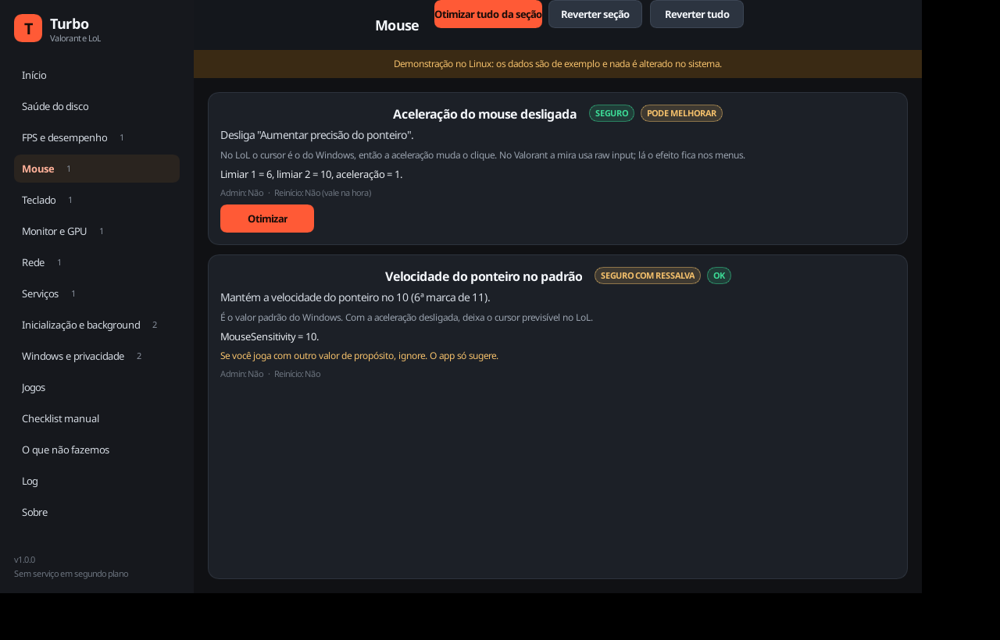

# Turbo

App de desktop para Windows 11 que deixa o PC mais previsível para Valorant e League of Legends. A interface é em português do Brasil, em tema escuro. Tudo o que ele altera é reversível. Não há serviço residente, não entra na inicialização e, ao fechar a janela, não sobra processo.

O programa abre como usuário comum (`asInvoker`). A elevação do UAC só acontece na hora de aplicar um item que escreve em `HKLM`, serviço ou placa de rede.

## Instalação

O instalador desta versão está em `dist/TurboApp-Setup.exe`. Também há o executável solto em `dist/turbo-app.exe`.

1. Copie `TurboApp-Setup.exe` para o Windows 11.
2. Execute. A instalação é por usuário, em `%LOCALAPPDATA%\TurboApp\app`, e não pede administrador.
3. Abre um atalho **Turbo** na área de trabalho e no menu Iniciar.
4. Na primeira tela, use **Criar backup agora** antes de otimizar qualquer coisa.

Para rodar sem instalar, basta o `turbo-app.exe`.

Desinstalar remove o programa e os atalhos. **Não** apaga `%LOCALAPPDATA%\TurboApp\backup.json` nem `log.jsonl`.

## Interface

A tela de início oferece o backup antes de qualquer alteração. Cada seção lista o estado lido no PC, o que vai mudar e os botões Otimizar e Reverter. Itens só de leitura não têm esses botões.





As imagens acima foram feitas no modo de demonstração (Linux, dados de exemplo). No Windows 11 a mesma interface lê e altera o PC de verdade.

## O que cada seção faz

São 21 itens em 10 seções. Só existe o que está na especificação. Item só de leitura mostra o estado e não tem botão de aplicar.

| Seção | O que o Turbo faz |
| --- | --- |
| Saúde do disco | Lê SMART, eventos 7/51/129/153 dos últimos 7 dias, quem está usando o disco (10 segundos) e se o Windows e o pagefile estão em SSD ou NVMe. O SysMain só pode ir para Manual se a medição mostrar que ele é o maior usuário de um HD. |
| FPS e desempenho | Desliga a gravação em segundo plano do Game DVR, garante o Modo de Jogo ligado e, se o plano for Equilibrado ou Economia, ativa o Alto desempenho. |
| Mouse | Desliga "Aumentar precisão do ponteiro" e sugere a velocidade 10. |
| Teclado | Desliga o atalho de Teclas de Aderência (Shift 5 vezes), Filtragem e Alternância. Os recursos continuam em Configurações. |
| Monitor e GPU | Sobe o monitor para o maior Hz da resolução atual, com confirmação de 15 segundos, e grava `SwapEffectUpgradeEnable=1` sem apagar os outros tokens do DirectX. |
| Rede | Desliga Energia Eficiente Ethernet, Power Saving Mode e Green Ethernet da placa cabeada. Mostra se o cabo negociou a velocidade máxima. Não roteia a conexão. |
| Serviços | Desliga o Spooler só quando não há impressora física. |
| Inicialização e background | Desativa itens da inicialização pelo mesmo mecanismo do Gerenciador de Tarefas, sem apagar a entrada Run. Não oferece botão para Segurança do Windows, Vanguard nem drivers de áudio e vídeo. Também desliga o Edge em segundo plano por política. |
| Windows e privacidade | Limita o diagnóstico ao nível Obrigatório (`AllowTelemetry = 1`) e desliga o ID de anúncio. O serviço DiagTrack não é desligado. |
| Jogos | Só lê TPM 2.0 e Secure Boot, que o Valorant exige. Nunca altera os dois. |

Cada seção tem **Otimizar tudo da seção** e **Reverter seção**. Esse botão geral ignora item só de leitura e os condicionais (SysMain e Spooler): esses só entram pelo botão do próprio item, quando a condição é verdadeira. **Reverter tudo** restaura, a partir do JSON original, o que o Turbo mudou.

Itens de `HKCU` aplicam na hora. Itens de administrador vão para uma cópia elevada do próprio exe (`--apply`), que aplica, grava o log e fecha. Depois de aplicar, o Turbo relê o valor. Se não bateu, restaura o original e marca falha.

A medição de disco usa os contadores em inglês (`PdhAddEnglishCounter`), então funciona com o Windows em português.

## Backup e reversão

Antes da primeira alteração o backup é obrigatório. A tela inicial oferece isso de cara.

1. **Ponto de restauração** por `SRSetRestorePoint` (o equivalente do WMI `SystemRestore.CreateRestorePoint`).
   - O Windows só cria **1 ponto a cada 24 horas**. Se já existe um de hoje, o Turbo usa esse e registra isso na tela e no log. Não contorna o limite.
   - Se a **Proteção do Sistema** está desligada, o app avisa com o caminho para ligar (Proteção do Sistema > Configurar) e só segue se você aceitar continuar só com o JSON.
   - Se o ponto falhar por outro motivo, o JSON ainda é salvo e o aviso fica explícito.
2. **JSON** em `%LOCALAPPDATA%\TurboApp\backup.json` com o valor original de cada item mutável, inclusive "não existia". Reverter apaga a chave que o Turbo criou e devolve a que já estava lá.

O log fica em `%LOCALAPPDATA%\TurboApp\log.jsonl` (data, item, ação, antes, depois). Reverter por item, por seção ou tudo sempre parte desse JSON, não de um estado intermediário.

A pasta do programa é `%LOCALAPPDATA%\TurboApp\app`. Backup e log ficam ao lado, fora dela, então atualizar ou desinstalar não os apaga.

## Atualização

Não há serviço nem tarefa agendada. Ao abrir, e no botão **Verificar atualizações**, o Turbo lê o manifesto público e compara a versão. A URL padrão já vem embutida no exe:

`https://github.com/NoShaar/turbo-app/releases/latest/download/latest.json`

Não precisa de `update-source.url`. Esse arquivo, ou a variável `TURBO_UPDATE_MANIFEST_URL`, só entra se você quiser apontar para outro manifesto.

O manifesto é o JSON de `releases/latest.json`. O instalador da versão 1.0.1 fica em:

`https://github.com/NoShaar/turbo-app/releases/download/v1.0.1/TurboApp-Setup.exe`

Se houver versão nova, o app mostra as notas. Se você aceitar, ele baixa o instalador, confere o **SHA-256** e a **assinatura Ed25519** com a chave pública embutida no exe, e só então inicia a instalação. Hash ou assinatura diferentes: o arquivo é descartado e nada é instalado.

### Como publicar uma versão que o atualizador encontre

A chave secreta **não está no git**. Sem ela, quem já instalou esta versão recusa a atualização. Guarde o arquivo `TURBO-SIGNING-KEY.txt` entregue com o build.

1. Suba a versão em `Cargo.toml`.
2. Compile (veja abaixo) e gere `dist/TurboApp-Setup.exe`.
3. Assine:

   ```text
   cargo run --bin turbo-sign -- sign --key TURBO-SIGNING-KEY.txt --file dist/TurboApp-Setup.exe > dist/SHA256SUMS.txt
   ```

   A saída tem o SHA-256 e a linha `# signature TurboApp-Setup.exe ...`.
4. Publique o instalador em HTTPS.
5. Atualize `releases/latest.json` com a versão, as notas, a URL HTTPS do instalador na release, o `sha256` e a `signature`.
6. Envie `TurboApp-Setup.exe`, `SHA256SUMS.txt` e `latest.json` para a release. O nome do asset do manifesto tem que ser `latest.json`, porque é o que a URL embutida baixa.

Uma tag `v*` dispara `.github/workflows/release.yml`. O workflow usa `GITHUB_TOKEN` com `contents: write` e publica a release anexando os arquivos já assinados e commitados: `dist/TurboApp-Setup.exe`, `releases/latest.json` e `releases/SHA256SUMS.txt` (ou `dist/SHA256SUMS.txt`). A compilação no Windows entra só como checagem e não substitui esses arquivos. A chave secreta não entra no repositório nem no workflow.

A chave pública correspondente está em `releases/update-public-key.txt` e é compilada dentro do exe. Trocar a chave exige reinstalar à mão: o app antigo não aceita arquivo assinado por outra chave.

## O que o app de propósito não faz

- Não desliga Defender, Windows Update, firewall, mitigações de CPU nem Integridade da Memória.
- Não mexe em Vanguard, serviços da AMD, Xbox, nem desliga o DiagTrack.
- Não usa `bcdedit`, HPET nem timer resolution.
- Não "limpa RAM" e não desliga o arquivo de paginação.
- Não aplica placebo de rede (`TcpAckFrequency`, `TCPNoDelay`, `NetworkThrottlingIndex`, `Win32PrioritySeparation`).
- Não mexe em MSI mode nem HAGS.
- Não atualiza driver sozinho.
- **Não roteia a conexão.** ExitLag e similares são um serviço pago de servidores, não um ajuste local. O Turbo só mostra a placa e o cabo. Ping e perda de pacote ficam nas estatísticas do Valorant.
- Não fecha processo, não remove programa, não faz overclock.

O checklist de Valorant, LoL, AMD Software e BIOS fica na aba **Checklist manual**, sem botão: o app não consegue aplicar isso com confiança.

## Se o app fechar sozinho

Um panic grava a mensagem e o backtrace em `%LOCALAPPDATA%\TurboApp\crash.log` e mostra uma caixa de diálogo. A 1.0.0 fechava na hora, sem janela, porque o diagnóstico inicializava COM em modo multithread na thread da interface e o winit recusava o `OleInitialize` (`RPC_E_CHANGED_MODE`, exceção `0xc0000409`). A partir da 1.0.1 o WMI e o resto do COM rodam numa thread de trabalho; a thread da janela fica livre para o modo STA.

## Compilar e rodar

Requisitos: Rust estável (1.88 ou mais novo). No Windows, o linker do MSVC ou do GNU. A interface usa a feature `ui`.

No Windows, a partir da pasta do projeto:

```text
cargo test --lib --bins
cargo run --release --features ui --bin turbo-app
```

O teste não precisa de Windows: o motor fala com um backend falso de registro, serviço, energia, mouse e inicialização. Os testes cobrem backup obrigatório, ponto de restauração (incluindo o limite de 24 h e a Proteção do Sistema desligada), aplicar, reler, falhar e reverter, e a conferência de hash e assinatura.

Cross-compile a partir do Linux (é como este repositório gerou o exe):

```text
sudo apt install gcc-mingw-w64-x86-64 nsis
rustup target add x86_64-pc-windows-gnu
./scripts/build-windows.sh
```

Isso produz `dist/turbo-app.exe` e, se o NSIS estiver instalado, `dist/TurboApp-Setup.exe`.

O CI (`.github/workflows/ci.yml`) roda os testes no Linux e compila o exe no `windows-latest`.

No Linux, `cargo run --features ui` abre a mesma interface em **modo de demonstração**, com dados de exemplo. Nada é escrito no sistema. O banner amarelo deixa isso explícito.

## Licença da interface

A UI usa Slint (licença royalty-free). A tela **Sobre** mostra **Made with Slint**, como a licença pede.
